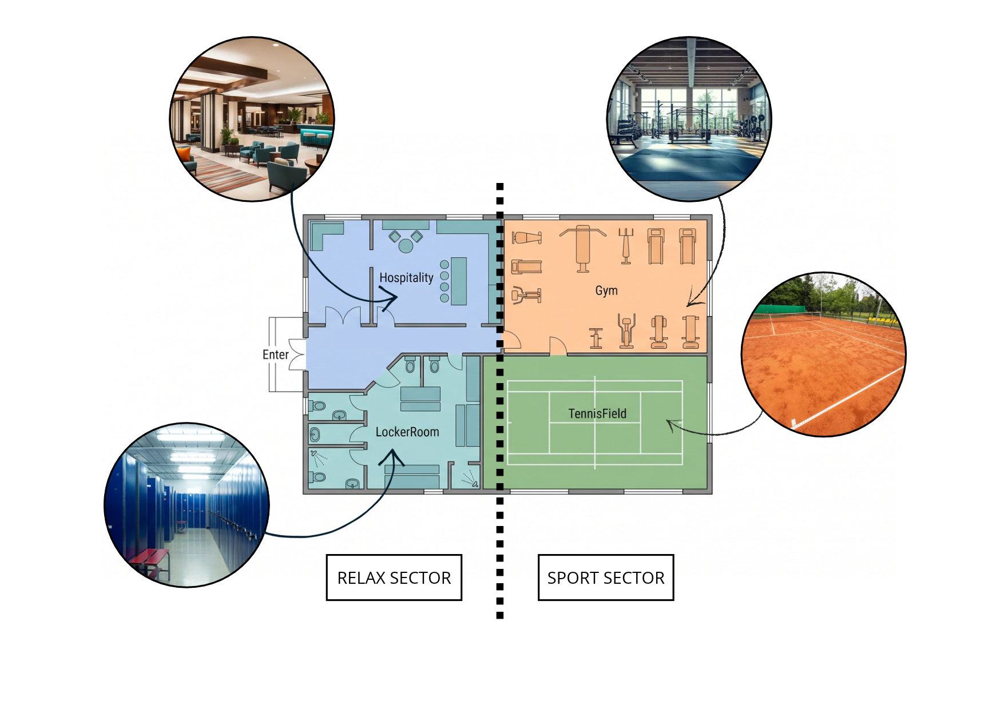
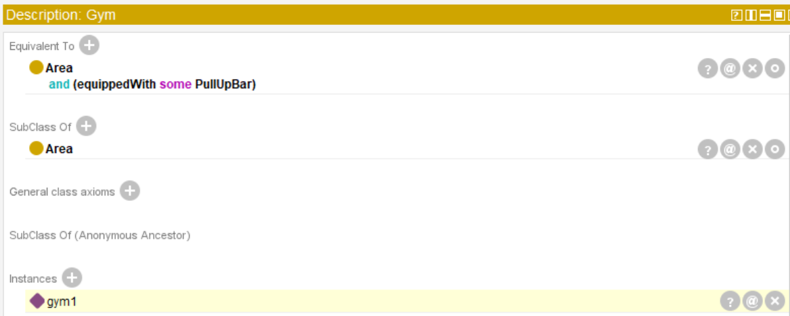
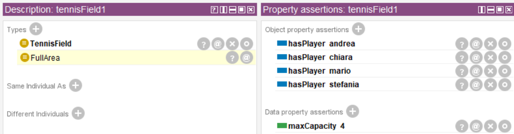
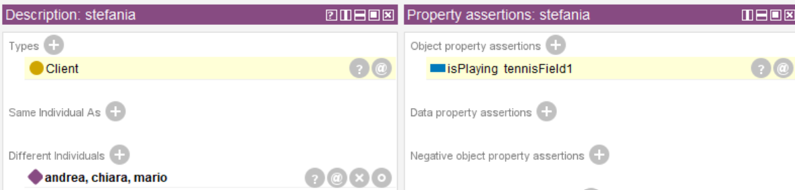
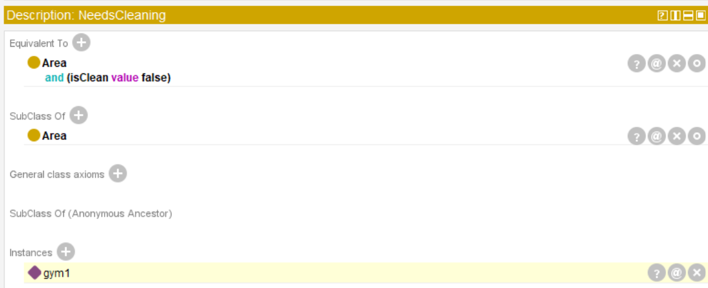
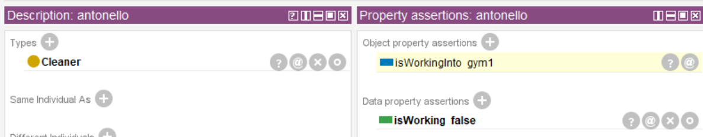
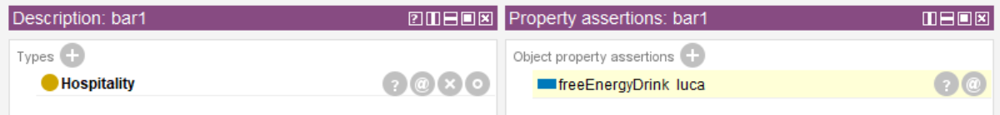
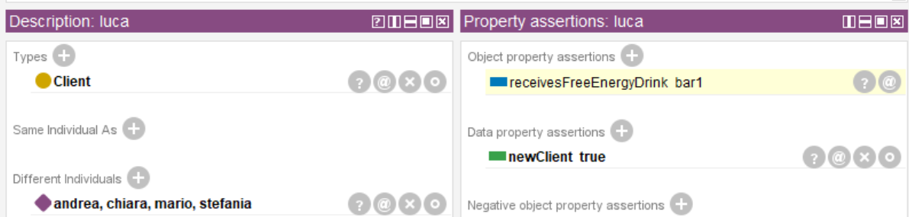

# Sports Center Ontology
**Ambient Intelligence – Assignment 1**

## 1. Project Overview

This project presents an OWL ontology developed using **Protégé** to model a sports center environment.

The sports center consists of different functional areas dedicated to sports activities, relaxation, and hospitality. These areas are organized into sectors and can be equipped with different types of equipment. 
The environment includes clients who use the facilities and staff members responsible for providing services and maintaining the center.

  
   
  
Figure 1: map of the center 

The main objective of this ontology is to represent the structure and relationships of the sports center while enabling automated reasoning about its environment.

In particular, the ontology aims to:

- Classify areas and sectors according to their equipment and facilities.
- Represent interactions between clients, staff members, and areas.
- Identify areas that have reached a defined occupancy threshold.
- Identify areas requiring cleaning.
- Model staff assignments using SWRL rules.
  
---

## 2. Ontology Structure

### 2.1 Class Hierarchy

The ontology is organized around four main classes:

- **Area:** Represents an individual facility or space within the sports center.
- **Equipment:** Represents the physical equipment or facilities available in the different areas.
- **Person:** Represents people interacting with the sports center, including clients and staff.
- **Sector:** Represents a functional section of the sports center, grouping different areas according to their purpose.

These classes are further divided into more specific subclasses.

| Main Class | Subclasses |
|---|---|
| Sector | Sport, Relax |
| Area | Gym, TennisField, LockerRoom, Hospitality, FullArea, NeedsCleaning |
| Equipment | PullUpBar, TennisBall, Shower, Bar |
| Person | Client, Staff |
| Staff | Barman, Trainer, Cleaner |

The distinction between **Sector** and **Area** was introduced to represent two levels of organization. A sector groups areas with a common purpose, while an area represents a specific facility.

The distinction between **Client** and **Staff** allows the ontology to represent different interactions with the environment. Clients participate in activities, while staff members perform work-related tasks.

### 2.2 Defined Classes

Some classes are defined using `Equivalent To` axioms rather than relying exclusively on `SubClass Of`.

This choice allows the reasoner to automatically classify individuals based on their properties.

> For example, a Gym is defined as:
>
>  `Area and (equippedWith some PullUpBar)`
>  
>  This means that an area equipped with at least one **PullUpBar** can be automatically classified as a **Gym**.
>
>  

>    
>     
>    
Figure 2: reasoner assumption of the <code>Gym</code> Area 

>  

Similarly, **TennisField** and **LockerRoom** are defined as **Area** with some **Equipment**.

The same mechanism was used to define the sectors:

> A Sport sector must include at least one Gym and one TennisField:
>
> `Sector and (includeArea some Gym) and (includeArea some TennisField)`

> A Relax sector must include at least one Hospitality area and one LockerRoom:
>
> `Sector and (includeArea some Hospitality) and (includeArea some LockerRoom)`

Finally, operational state classes are also defined via property restrictions:
* **NeedsCleaning**: an `Area` whose `isClean` data property is set to `false`.
* **FullArea**: a `Gym` with at least 6 distinct `Client` players, or a `TennisField` with at least 4 distinct `Client` players.

These definitions enable the reasoner to identify the function of an area or sector based on its relationships, rather than requiring every type to be manually asserted.

---

## 3. Object Properties

Object properties represent relationships between individuals.

### Object Properties

| Object Property | Domain | Range | Characteristics | Description |
|---|---|---|---|---|
| `equippedWith` | `Area` | `Equipment` | - | Associates an area with its equipment |
| `includeArea` | `Sector` | `Area` | - | Associates a sector with its areas |
| `hasPlayer` | `Area` | `Client` | Inverse of `isPlaying` | Identifies clients playing in an area |
| `isPlaying` | `Client` | `Area` | Inverse of `hasPlayer` | Identifies the area in which a client is playing |
| `isWorkingInto` | `Staff` | `Area` | Functional | Associates a staff member with a working area |
| `freeEnergyDrink` | `Hospitality` | `Client` | Inverse of `receivesFreeEnergyDrink` | Associates a hospitality area with a new client receiving a free energy drink |
| `receivesFreeEnergyDrink` | `Client` | `Hospitality` | Inverse of `freeEnergyDrink` | Identifies the hospitality area offering a free energy drink to a new client |

The properties `hasPlayer`/`isPlaying` and `freeEnergyDrink`/`receivesFreeEnergyDrink` are defined as **inverse properties**.
> This allows the reasoner to infer one relationship from the other. For example, if a tennis field has a particular client as a player, the reasoner can also infer that the client is playing in that tennis field.

The `equippedWith` property is particularly important because it is used in several defined classes to automatically classify areas according to their equipment.

The `includeArea` property serves a similar purpose at the sector level, enabling automatic classification based on the types of areas included.

---

## 4. Data Properties

Data properties associate individuals with literal values rather than other individuals.

Four data properties have been introduced:

| Data Property | Domain | Type | Purpose |
|---|---|---|---|
| maxCapacity | Area | integer | Represents the maximum capacity of an area |
| isClean | Area | boolean | Represents the cleaning status of an area |
| isWorking | Staff | boolean | Represents the working status of a staff member |
| newClient | Client | boolean | Indicates whether a client is newly registered |

### 4.1 Maximum Capacity

The `maxCapacity` property represents the maximum number of clients allowed in an area.

> For example, `tennisField1` has a maximum capacity of 4, while `gym1` has a maximum capacity of 6.

Since standard OWL class restrictions do not directly compare a data property value with the number of related individuals, the ontology currently defines FullArea using explicit cardinality restrictions for different types of areas. Therefore, it was included for completeness to describe the domain, although it is not directly used by any defined class or SWRL rule

### 4.2 Cleaning Status

The `isClean` property represents whether an area is clean.

> The defined class `NeedsCleaning` uses the following expression:
>
> `Area and (isClean value false)`

This allows an area explicitly marked as not clean to be automatically classified as NeedsCleaning.

### 4.3 Staff Working Status

The `isWorking` property represents whether a staff member is currently working.

This information can be combined with SWRL rules to infer relationships between staff members and areas.

### 4.4 New Client Status

The `newClient` property indicates whether a client is newly registered at the sports center.

This information is combined with SWRL rules to automatically assign welcome benefits to new clients.

---

## 5. Occupancy Reasoning

The ontology introduces the defined class `FullArea` to represent areas that have reached a specific occupancy threshold.

Different types of areas have different capacity requirements:

- A Gym is considered full when it has at least 6 clients.
- A TennisField is considered full when it has at least 4 clients.

> The class is defined as:
>
> `(Gym and (hasPlayer min 6 Client)) or (TennisField and (hasPlayer min 4 Client))`

This definition enables automatic classification based on the number of distinct clients associated with an area.

---

## 6. Individuals and Property Assertions

The ontology includes concrete individuals representing sports facilities, clients, and staff members.

> Examples include:
> 
> - `gym1`,`tennisField1`: individual asserted as Area.
> - `antonello`: individual of Cleaner.
> - `andrea`, `chiara`, `mario`, `stefania`: individuals associated with tennisField1 through hasPlayer.

The ontology also includes assertions describing area capacities, cleaning status, and staff working status.

These individuals and assertions provide the basis for testing the reasoning capabilities of the ontology.

---

## 7. SWRL Rules

SWRL (Semantic Web Rule Language) is used to express additional logical relationships that complement the OWL class definitions.

The ontology includes two rules:

1. **Cleaner Assignment:** Associates an available `Cleaner` with an `Area` explicitly marked as not clean.

  > `Cleaner(?c), isWorking(?c, false), Area(?a), isClean(?a, false) -> isWorkingInto(?c, ?a)`

  The intended purpose is to infer a working relationship between an available cleaner and an area requiring cleaning.

2. **"Welcome" Energy Drink:** Associates a `Hospitality` area with any `Client` marked as newly registered.

  > `Client(?c), newClient(?c, true), Hospitality(?h) -> freeEnergyDrink(?h, ?c)`

  The intended purpose is to automatically offer a free energy drink to new clients through the hospitality area.

---

## 8. Expected Reasoner Conclusions

The ontology demonstrates automatic classification and property inference using the HermiT reasoner.

Below are the three main conclusions produced by the reasoner:

### 1. Full Area Classification and Inverse Playing Inference

- **Assertions:** `tennisField1` (inferred as `TennisField`) is associated with four distinct clients (`andrea`, `chiara`, `mario`, `stefania`) through `hasPlayer`.
- **Inferred Knowledge:** Since the minimum cardinality of 4 clients for a tennis field is reached, `tennisField1` is automatically classified as `FullArea`. At the same time, due to the inverse property axiom between `hasPlayer` and `isPlaying`, the reasoner infers `isPlaying tennisField1` (and the `Client` class) for all four players.

  
  
   
  
Figure 3: Automatic classification of <code>tennisField1</code> as <code>FullArea</code>

### 2. Cleaning Requirement and Cleaner Assignment

- **Assertions:** `gym1` has `isClean` set to `false`, while `antonello` is asserted as a `Cleaner` with `isWorking` set to `false`.
- **Inferred Knowledge:** `gym1` is automatically classified as `NeedsCleaning` via its defined class restriction, and the first SWRL rule assigns `antonello` to work in that area (`isWorkingInto gym1`).

  
  
   
  
Figure 4: Automatic classification of <code>gym1</code> as <code>NeedsCleaning</code></em>

### 3. Welcome Energy Drink Assignment for New Clients

- **Assertions:** `luca` is asserted as a `Client` with `newClient` set to `true`, and `bar1` is asserted as a `Hospitality` area.
- **Inferred Knowledge:** The second SWRL rule infers `freeEnergyDrink luca` on `bar1`. Thanks to the inverse property axiom, the reasoner simultaneously infers `receivesFreeEnergyDrink bar1` on `luca`.

  
  
   
  
Figure 4: SWRL-inferred <code>freeEnergyDrink</code> on <code>bar1</code>

---

## 9. Running the Ontology

The ontology can be opened using Protégé.

1. Open Protégé and load the provided `Assignment1.owl` file.
2. Inspect the class hierarchy, object properties, data properties, and individuals.
3. Select the HermiT reasoner.
4. Start the reasoner to classify the ontology.
5. Inspect inferred class memberships and object property assertions.
6. Verify that the expected conclusions are produced.

The SWRL rules can be inspected through the Rules view in Protégé.

---

## Authors

This project was developed as a collaborative group project for the Ambient Intelligent course in Robotics Engineering Master's Degree at the University of Genoa.

  
  &nbsp;&nbsp;&nbsp;&nbsp;
   
  &nbsp;&nbsp;&nbsp;&nbsp;
   

